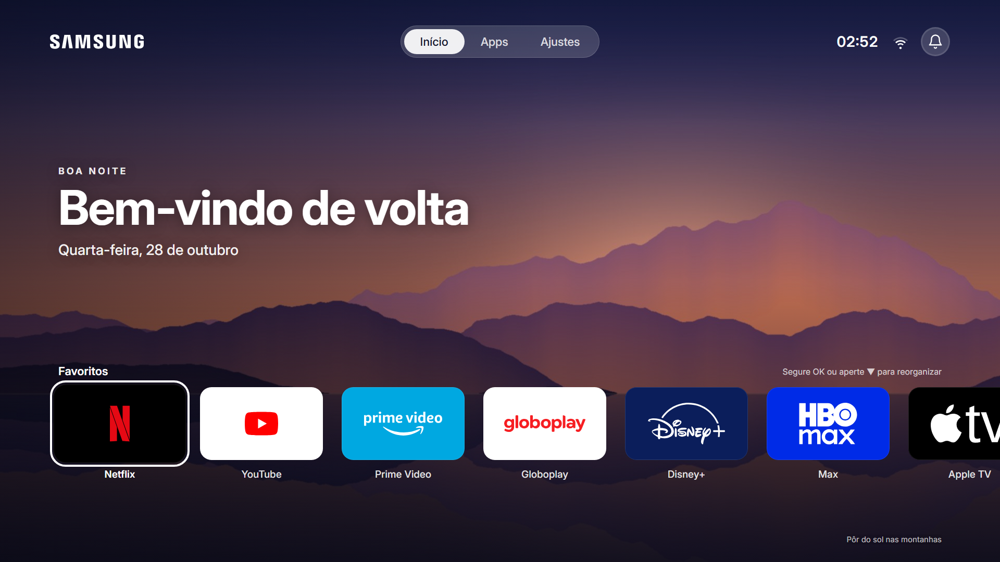
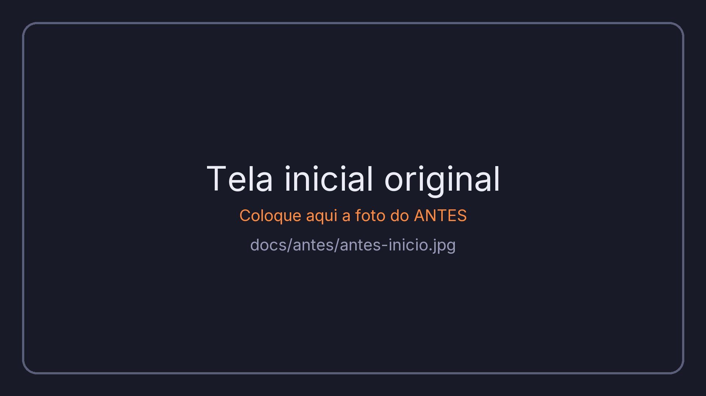
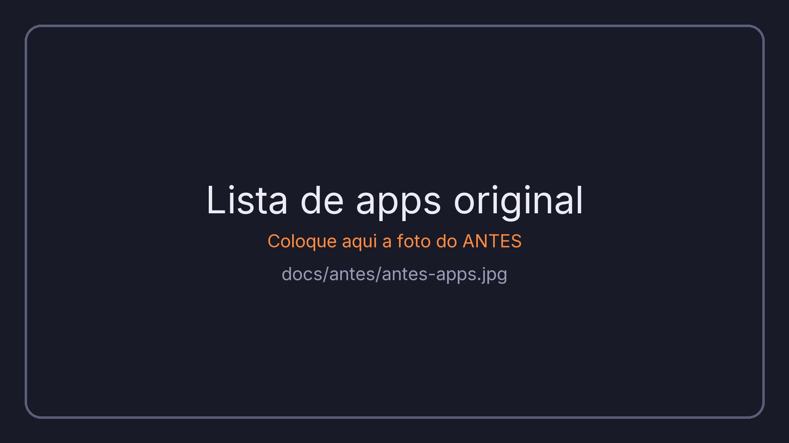
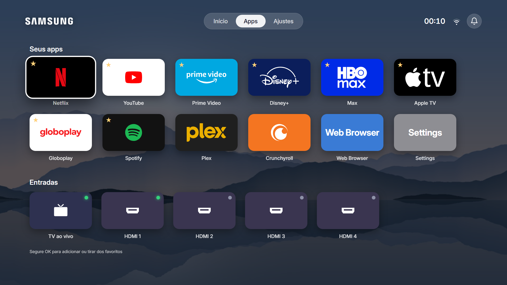
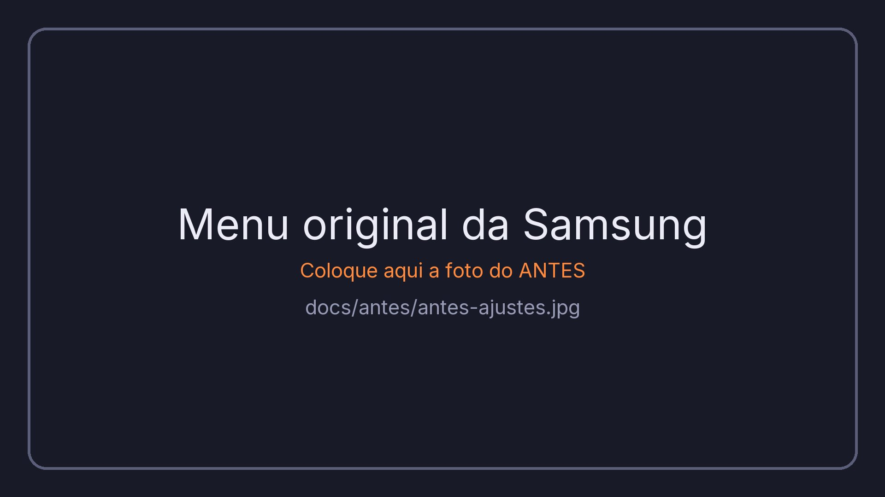
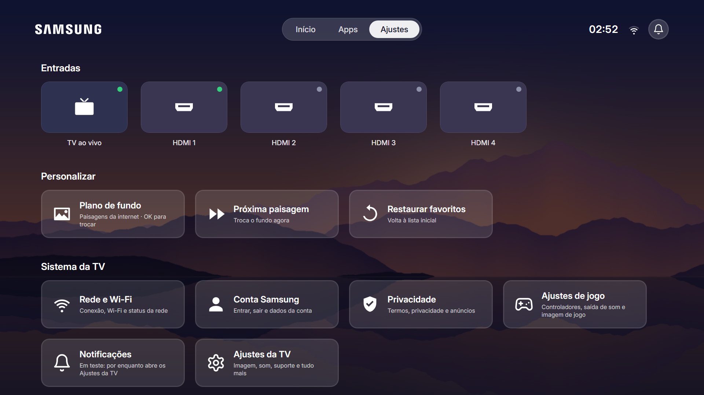
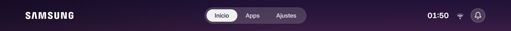

<div align="center">

# 🌅 Dusk TV

**Uma tela inicial limpa, rápida e personalizável para Smart TVs Samsung (Tizen).**

Paisagens que mudam sozinhas, seus apps com os logos de verdade, relógio, Wi-Fi e notificações. Sem propaganda,
sem fileiras patrocinadas.


-0F172A?style=for-the-badge)




</div>

---

## Sumário

- [Antes e depois](#-antes-e-depois)
- [Telas](#-telas)
- [Funcionalidades](#-funcionalidades)
- [Compatibilidade](#-compatibilidade)
- [Tecnologias](#-tecnologias)
- [Instalação na TV](#-instalação-na-tv)
- [Personalização](#-personalização)
- [Estrutura do projeto](#-estrutura-do-projeto)
- [Limites do Tizen](#-limites-do-tizen)
- [Como desfazer](#-como-desfazer)
- [Contribuindo](#-contribuindo)
- [Créditos](#-créditos)
- [Licença](#-licença)

---

## 🔄 Antes e depois

| Antes (Smart Hub da Samsung) | Depois (Dusk TV) |
| :---: | :---: |
|  |  |
|  |  |
|  |  |

> 📸 Para trocar as fotos do "antes", substitua os arquivos de [`docs/antes/`](docs/antes) mantendo os mesmos nomes.

---

## 🖼️ Telas

### Início
Saudação conforme o horário, data, paisagem de fundo com a legenda do lugar e a fileira de **Favoritos**.
Segure **OK** num favorito para arrastá-lo com as setas.


### Apps
Todos os apps instalados e as entradas da TV, cada um com o **logo oficial** sobre a cor da marca.
Segure **OK** para colocar ou tirar dos favoritos (⭐).


### Ajustes
Entradas (TV ao vivo e HDMI 1 a 4, com um ponto verde quando há um aparelho ligado), plano de fundo, Rede e
Wi-Fi, Conta Samsung, Privacidade, Notificações e todos os ajustes da TV.


### Barra superior
Logo da Samsung, abas, relógio, força do sinal do **Wi-Fi** (ou o ícone de cabo de rede) e o **sino**, que abre
o painel de notificações da Samsung.



---

## ✨ Funcionalidades

- 🏞️ **Paisagens novas todo dia:** as "imagens do dia" do Bing (sem chave e sem cadastro), trocando a cada 20 minutos.
  Fotos de bichos, de interiores e de obras de arte ficam de fora.
- 📴 **Funciona sem internet:** 5 paisagens salvas no próprio app entram quando a rede cai.
- 🎨 **Logos de verdade** para cerca de 30 apps: Netflix, YouTube, Prime Video, Globoplay, Disney+, HBO Max,
  Apple TV, Spotify, Twitch, Crunchyroll, Plex, Paramount+, PlayStation, Xbox e outros.
- ⭐ **Favoritos editáveis pelo controle:** adicionar, tirar e reorganizar.
- 📶 **Status da rede** em tempo real: força do Wi-Fi ou cabo.
- 🔔 **Notificações** da Samsung a um clique.
- 🔌 **Entradas HDMI** com status de conexão.
- ⚙️ **Identidade visual** num só arquivo: logo, cor de destaque, tipo de fundo e favoritos iniciais.
- 🪶 **Leve:** JavaScript puro, sem frameworks e sem efeitos de blur, para manter 60 fps em TVs mais simples.
- ↩️ **Reversível:** não mexe no sistema da TV, no botão Home nem no Smart Hub.

---

## 📺 Compatibilidade

| | |
| --- | --- |
| **Feito para** | Samsung UN60AU8000GXZD (Crystal UHD 2021, Tizen 6.0) |
| **Deve funcionar em** | TVs Samsung com Tizen 3.0 ou mais novo (2017 em diante) |
| **Certificado** | TVs de 2015 a 2022: certificado Tizen comum. TVs de 2023 em diante: certificado Samsung |
| **Resolução da interface** | 1920×1080, ajustada à tela |

> Testou em outro modelo? Abra uma [issue](../../issues) contando como foi, para entrar nesta tabela.

---

## 🧰 Tecnologias

| Parte | O que usa |
| --- | --- |
| Interface | HTML5, CSS3 e JavaScript **ES5** (o navegador das TVs Tizen é antigo), fonte [Inter](https://rsms.me/inter/) |
| Integração com a TV | APIs web do Tizen: `tizen.application` (apps), `tizen.systeminfo` (Wi-Fi e rede), `tizen.tvwindow` (HDMI) |
| Paisagens online | Arquivo de imagens do dia do Bing (`HPImageArchive`), sem chave |
| Empacotamento | Python 3 (`tizen/build.py`) e o `tizen package` do Tizen SDK 10 (antigo Tizen Studio) para assinar |
| Instalação | Python 3 (`tizen/install.py`), que fala o protocolo SDB da TV direto, sem precisar do `sdb` |
| Base | Camada de TV do [Free My TV](https://github.com/simbasjungles/free-my-tv) (MIT) |

---

## 🚀 Instalação na TV

Os passos 1 a 3 são feitos uma vez só.

**1. Na TV, ligue o Modo Desenvolvedor**
1. Abra **Apps** e espere a tela carregar.
2. Digite `1 2 3 4 5` no controle **rápido, em no máximo 2 segundos**. Mais devagar que isso, a TV ignora e a
   janela não abre.
   - No Smart Remote (o controle sem números), aperte o botão **123** para abrir o teclado numérico na tela antes.
3. Ligue o **Developer mode**.
4. Em **Host PC IP**, coloque o IP do seu computador. No Windows, rode `ipconfig` e use o "Endereço IPv4" do
   adaptador **Wi-Fi** ou **Ethernet**, que é o que tem "Gateway Padrão" preenchido (algo como `192.168.0.x`).
   Ignore IPs que começam com `169.254` e adaptadores de VPN (Tailscale, Hamachi etc.): a TV não alcança esses
   endereços.
5. Desligue e ligue a TV: segure o botão de ligar até ela reiniciar.
6. Anote o IP da TV, que aparece em Configurações → Geral → Rede → Status da rede → Configurações de IP. Ele é
   usado no passo 4, no comando `install.py`.

> **Errou o IP do computador?** Repita os passos 1 e 2. A mesma janela abre de novo para você corrigir o
> **Host PC IP**. Depois, reinicie a TV.

**2. No computador, instale o Tizen SDK**

O Tizen Studio agora se chama **Tizen SDK** e fica na página de [Tools do Samsung Tizen OS](https://samsungtizenos.com/tools-download/).
No Windows, baixe a versão com interface gráfica, que já traz o Certificate Manager:

- **Windows (64-bit):** [web-ide_Tizen_SDK_10.0_windows-64.exe](https://download.tizen.org/sdk/Installer/tizen-sdk_10.0/web-ide_Tizen_SDK_10.0_windows-64.exe)
- **Outros sistemas e espelhos:** [download.tizen.org/sdk/Installer/tizen-sdk_10.0](https://download.tizen.org/sdk/Installer/tizen-sdk_10.0/)

Instale na pasta sugerida (`C:\tizen-studio`). Se escolher outra, defina a variável de ambiente `TIZEN_STUDIO`
com o caminho. Também é preciso ter o [Python 3](https://www.python.org/downloads/).

> Se o Windows bloquear o instalador, clique em "Mais informações" e depois em "Executar assim mesmo". O instalador
> precisa do Java, e oferece para instalar se não encontrar.

**3. Crie o certificado**

1. Abra o **Certificate Manager**: no menu Iniciar, ou em `C:\tizen-studio\tools\certificate-manager\`.
2. Clique em **+** e escolha o tipo:
   - **Tizen:** TVs de 2015 a 2022, como a UN60AU8000.
   - **Samsung:** TVs de 2023 em diante. Precisa da extensão *Samsung Certificate Extension*, instalada pelo
     Package Manager do SDK, e de login na conta Samsung.
3. Dê o nome `dusk` ao perfil e crie um certificado de autor novo, com uma senha só sua.

**Atalho para TVs até 2022 (Windows):** em vez do Certificate Manager, rode o script abaixo. Ele pede uma senha e
cria o certificado e o perfil `dusk` sozinho.

```bash
powershell -ExecutionPolicy Bypass -File tools\criar-certificado.ps1
```

**4. Gere e instale o app**

```bash
git clone https://github.com/mkrosz/dusk-tv-samsung.git
cd dusk-tv-samsung
python tizen/build.py --sign dusk
python tizen/install.py IP_DA_TV
```

Troque `IP_DA_TV` pelo IP que você anotou no passo 1 (por exemplo, `python tizen/install.py 192.168.0.20`). O
app abre sozinho na TV no fim do último comando.

**5. Na TV, faça ela já ligar no Dusk TV**

Este passo é feito **na TV, com o controle** (não no Tizen Studio):

1. Aperte **Home**, vá até a engrenagem **⚙ Configurações** e entre em **Todas as configurações**.
2. Entre em **Geral** → **Recursos Smart**.
3. Ligue **Executar automaticamente último app** (*Autorun Last App*).
4. Abra o Dusk TV uma vez e desligue a TV com ele aberto. Da próxima vez, ela liga direto nele.

> Mudou alguma coisa? Rode de novo só o passo 4.

---

## 🎨 Personalização

Toda a identidade visual fica em [`web/config.js`](web/config.js):

```js
window.DUSK = {
  logo: 'logos/samsung.svg',   // logo do canto (ou '' para mostrar o texto de `brand`)
  brand: 'Samsung',
  accent: '#FF8A3D',           // cor do item em foco
  wallpaper: 'online',         // 'online' (paisagens da internet) ou 'salvas'
  rotateMinutes: 20,           // de quantos em quantos minutos a paisagem troca
  favorites: ['Netflix', 'YouTube', 'Prime Video', 'Globoplay', 'Disney+', 'Max', 'Apple TV', 'Spotify']
};
```

- **Fotos offline:** troque os arquivos de [`web/wallpapers/`](web/wallpapers) por fotos suas de 1920×1080, com
  os mesmos nomes.
- **Logos:** ficam em [`web/logos/`](web/logos), e a lista que liga cada app ao logo e à cor fica em `LOGOS`, no
  [`web/home.js`](web/home.js).
- **Ver no computador, sem TV:** rode `python -m http.server 8765 -d web` e abra <http://localhost:8765>.
  As setas navegam, Enter abre e Esc volta. Use `#apps` ou `#settings` no endereço para abrir direto numa aba.

---

## 🗂️ Estrutura do projeto

```text
dusk-tv-samsung/
├── web/                  # o app (o que vai para a TV)
│   ├── index.html
│   ├── home.js           # telas, foco, favoritos, paisagens
│   ├── home.css          # visual
│   ├── tv.js             # ponte com a TV: apps, HDMI, Wi-Fi, notificações
│   ├── config.js         # sua identidade visual
│   ├── logos/            # logos dos apps (fontes em FONTES.txt)
│   └── wallpapers/       # 5 paisagens para quando estiver sem internet
├── tizen/
│   ├── config.xml        # manifesto do app Tizen (id, versão, permissões)
│   ├── build.py          # gera e assina o DuskTV.wgt
│   └── install.py        # instala na TV pela rede
└── docs/                 # capturas de tela e fotos do "antes"
```

---

## ⚠️ Limites do Tizen

- **Notificações:** a Samsung não divulga qual app abre o painel de notificações. O sino tenta os nomes conhecidos
  e procura um app de notificações na TV. Se não achar nenhum, abre os Ajustes.
- **Conta, Privacidade e Rede:** um app só consegue abrir os Ajustes no começo, não numa página específica. Por
  isso cada cartão mostra o caminho a seguir lá dentro.
- **Botão Home:** continua abrindo o Smart Hub. Por segurança, ele não é remapeado.
- **Modo Desenvolvedor:** precisa continuar ligado para o app funcionar.

---

## ↩️ Como desfazer

- **Pelo computador:** `python tizen/install.py IP_DA_TV --uninstall`
- **Pela TV:** Apps → ⚙ → Dusk TV → Excluir.
- Desligue o "Executar automaticamente o último app" e a TV volta ao Smart Hub normal.

---

## 🤝 Contribuindo

Sugestões, correções e versões novas são bem-vindas.

1. Faça um **fork** do projeto.
2. Crie um branch: `git checkout -b minha-melhoria`.
3. Faça o commit: `git commit -m "Adiciona minha melhoria"`.
4. Envie: `git push origin minha-melhoria`.
5. Abra um **Pull Request**.

Ideias abertas: novos temas, mais logos, suporte testado em outros modelos e telas em outros idiomas.

---

## 🙏 Créditos

- **Inspiração visual:** o launcher "dusk" que [@lucataco](https://x.com/lucataco) mostrou numa TV LG.
- **Camada de TV, instalador e ícones de apoio:** [Free My TV](https://github.com/simbasjungles/free-my-tv)
  (MIT, veja [`LICENSE-FreeMyTV`](LICENSE-FreeMyTV)).
- **Logos:** [Simple Icons](https://simpleicons.org) (CC0) e Wikimedia Commons. Detalhes em
  [`web/logos/FONTES.txt`](web/logos/FONTES.txt).
- **Fonte:** [Inter](https://rsms.me/inter/) (SIL Open Font License).
- **Paisagens online:** imagens do dia do [Bing](https://www.bing.com), exibidas direto do Bing e não guardadas
  neste repositório.

> As marcas e logos pertencem aos seus donos. Este projeto não tem ligação com a Samsung nem com os serviços
> citados.

---

## 📄 Licença

Distribuído sob a licença **MIT**. Veja [`LICENSE`](LICENSE).

<div align="center">

Feito com ☕ e [Claude Code](https://claude.com/claude-code) por [@mkrosz](https://github.com/mkrosz)

</div>
